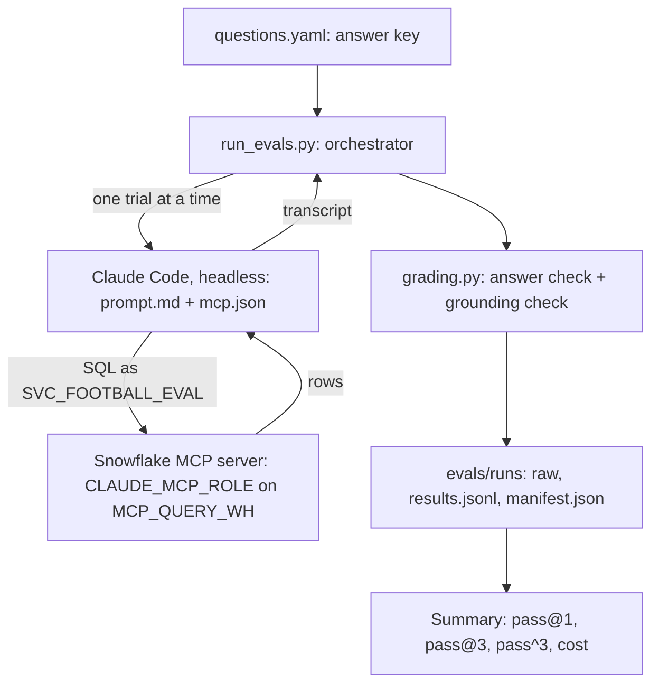

# Football evals

## Commands

Run every command from the repo root.

| I want to... | Command |
|---|---|
| See every option the script has | `uv run python evals/run_evals.py --help` |
| Check it loads, with no calls and no cost | `uv run python evals/run_evals.py --dry-run --only L1` |
| Pilot: one question, once | `uv run --env-file secrets/.env.eval python evals/run_evals.py --only L1 --trials 1` |
| Run a few questions | `uv run --env-file secrets/.env.eval python evals/run_evals.py --only L1 A3 R1` |
| Full baseline: every question, 3 times | `uv run --env-file secrets/.env.eval python evals/run_evals.py` |
| Run the hint-free set | `uv run --env-file secrets/.env.eval python evals/run_evals.py --questions evals/questions_hard.yaml` |
| Run the hint-free set with a context file | `uv run --env-file secrets/.env.eval python evals/run_evals.py --questions evals/questions_hard.yaml --context evals/context.md` |
| Read a run's results, nicely indented | `uv run python -m json.tool --json-lines evals/runs/<run folder>/results.jsonl` |
| See why trials failed: answer, reading, checks and the SQL run | `uv run python evals/show_failures.py evals/runs/<run folder>` |
| Run the tests (no secrets needed) | `uv run pytest evals/tests` |

How a command is built:

```
uv run   --env-file secrets/.env.eval   python evals/run_evals.py   --only L1 --trials 1
  1                  2                             3                         4
```

1. `uv run`: use this project's Python and packages.
2. `--env-file ...`: load the secrets for this one command only. Leave it out
   when no secrets are needed (`--dry-run`, `--help`, tests).
3. `python <file>`: the script to run.
4. Flags: the script's own options. `--help` lists them, so there's no need
   to memorise them.

A small, versioned answer key for testing an LLM agent that answers
natural-language questions against the Snowflake gold layer through the
`Football_Snowflake` MCP connector.

## How it fits together



## Answer keys

- **`questions.yaml`** is the regression suite. Each question carries its own
  hints ("fee greater than zero, 1 July to 30 June"), so it mostly tests
  whether the agent follows precise instructions. It scored 100% on 15 Oct
  2026 and should stay there.
- **`questions_hard.yaml`** asks the same verified facts the way a user
  would, without the hints. Run once without and once with `--context`;
  the score difference measures what the context file is worth.

The rest of this section applies to both files.

Each entry has the question, an `expected` answer, the `sql` that produced
it, and a `cross_check_sql` written a different way that must agree. Every
query was run through the connector as `CLAUDE_MCP_USER` /
`CLAUDE_MCP_ROLE`, the same read-only grants the agent under test has, so
every answer is reachable within its scope.

The questions are pinned to closed periods (seasons up to 2023/24,
explicit transfer date ranges) so the weekly prod rebuild doesn't quietly
change the expected answers. `data_snapshot` records the data's
`loaded_timestamp` at verification time; if prod has moved past it, re-run
the SQL before trusting a score.

## Grading

The agent's reply must end with `ANSWER: <value>` (or `ANSWER: REFUSE`).

| `answer_type` | Pass when |
|---|---|
| `number` | the absolute difference from `expected` is within `tolerance` |
| `name` | it matches any value in `accept`, case-insensitive |
| `refuse` | the answer is exactly `REFUSE` |

**Several defensible readings.** A hint-free question can have more than
one fair answer ("average fee": paid transfers only, or free transfers
too?). Such a question lists each one under `readings`, with its own
`label`, `expected` value and verified SQL, and any of them passes.
`results.jsonl` records which reading the agent chose in `reading`, and the
grounding check uses that reading's value. Refusing a question that has
readings fails.

**Grounding check.** For every answerable question, the expected value
(or an alternative listed under `grounding`) must also appear in the rows
returned by at least one SQL query the agent actually ran. This catches
answers recalled from training data: famous facts like Haaland's 36 goals
can be "known" without querying. A trial passes only when both checks
pass. Both are logged separately, so a gap between the answer-only score
and the grounded score shows how often the agent is guessing.

**Scores.**

- **pass@1** is the share of all trials that passed.
- **pass@3** is the share of questions that passed at least once in 3
  trials.
- **pass^3** is the share of questions that passed all 3 trials. This is
  the consistency measure. A data agent that's right two times in three
  isn't one people can rely on.

## Running the evals (`run_evals.py`)

Each question runs through headless Claude Code (`claude --bare -p`),
connected only to Snowflake's managed MCP server, the same server the
Claude.ai connector uses, with every built-in tool switched off. Every
trial starts a fresh session.

**Run it locally, not in a cloud session.** One-time setup:

- **Snowflake login for scripts.** Run `snowflake/mcp/mcp_eval_access.sql`.
  It creates `SVC_FOOTBALL_EVAL`, a service user with `CLAUDE_MCP_ROLE`, a
  network policy for your IP and a 30-day token. It's a separate user from
  the Claude.ai connector's `CLAUDE_MCP_USER`, because a token needs a
  network policy and a network policy would block the connector. The
  script's header explains this in full.
- **`secrets/.env.eval`** (gitignored, never committed) must define:
  - `SNOWFLAKE_MCP_URL`, set to
    `https://<account>.snowflakecomputing.com/api/v2/databases/PRD_ANALYTICS/schemas/FOOTBALL_GOLD/mcp-servers/FOOTBALL_MCP_SERVER`.
    Use hyphens, not underscores, in the account host.
  - `SNOWFLAKE_MCP_PAT`, the token.
  - `ANTHROPIC_API_KEY`. `--bare` never reads a stored login, so the key
    has to be in the environment.

Then:

```
uv run --env-file secrets/.env.eval python evals/run_evals.py --only L1 --trials 1   # pilot: check cost and wiring
uv run --env-file secrets/.env.eval python evals/run_evals.py                       # full baseline: 11 x 3
uv run python evals/run_evals.py --dry-run                                          # print commands only
```

Spending is capped per trial (`--max-budget-usd`, default 0.50) and per
run (`--max-total-usd`, default 10).

## Logs

Every run writes to `evals/runs/<UTC timestamp>_<git sha>/`. **Runs are
local-only:** `evals/runs/` is gitignored. The one exception is the
15 Oct 2026 baseline (`20261015T134903Z_cc0b1c0c`, without its `raw/`
folder), committed before the ignore rule as a reference point. Record
later results in the project's notes, not in git.

| File | Contents |
|---|---|
| `raw/<qid>_t<n>.jsonl` | The complete stream-json transcript of each trial: every model turn, tool call and Snowflake reply |
| `results.jsonl` | One graded row per trial: answer, both checks, SQL run with Snowflake `query_id`s, tokens, cost, errors |
| `manifest.json` | Run configuration, versions (git SHA, model, Claude Code version, answer key and prompt hashes) and summary scores |

The logs are JSONL so a crashed run still leaves valid rows, and so
Snowflake can load them directly (`COPY INTO` a VARIANT column) when they're
later analysed alongside the football data. Any occurrence of the Snowflake
token or API key is replaced with `[REDACTED]` before anything is written.

**Snowflake cost for a run.** Run this as an admin role, not the agent's.
`ACCOUNT_USAGE` lags by up to about 3 hours.

```sql
select sum(credits_used) as credits
from snowflake.account_usage.warehouse_metering_history
where warehouse_name = 'MCP_QUERY_WH'
  and start_time >= '<manifest started_at>'
  and end_time <= dateadd(hour, 1, '<manifest ended_at>');
```

Per-query detail: join the `query_id`s in `results.jsonl` to
`snowflake.account_usage.query_history`.

## Authorship

The questions were chosen and reviewed by Tom. The SQL was drafted by
Claude, cross-checked, then reviewed line by line. The agent under test is
the same model family, so the answer key could share its blind spots;
independent cross-checks and human review are the mitigation.

## Data note

The data includes player names (personal data). It's public Transfermarkt
data about public figures, so the risk is low, but it's flagged here per
the repo's review standard.

## Known data defect

`competition_name` isn't unique: `premier-liga` is both Russia's and
Ukraine's league, so `fct_player_performance_per_season_competition`
merges the two, and joining it to `dim_competitions` on name doubles
the rows. No question here depends on it; fixing it changes the fact's
grain and is tracked in mcbreese/football_snowflake#76.
